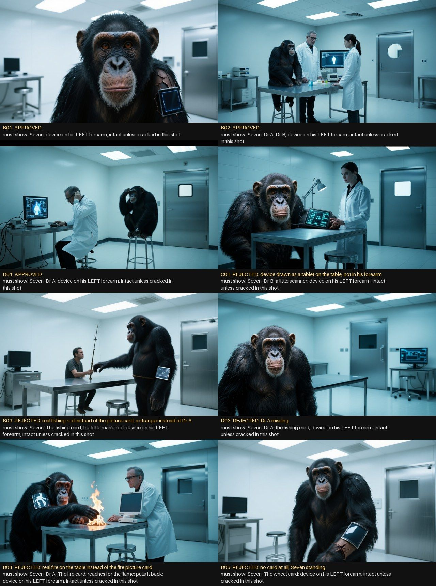

# Monkey's Life — shot status

Generated by `episode1/status.py`. Facts only: a shot is APPROVED after its picture or clip was actually looked at.
Reviewers: open a GitHub issue titled with the shot ID (e.g. "B03: ...") to request a change.
**Approved footage: 0.2 of 3.0 planned minutes in production.**

## Scene 1 — The Lab

| Shot | Sec | Action (script) | State | Note |
|---|---|---|---|---|
| B01 | 5.0 | Black. Then his eyes open, very close, and white light floods in. | clip REJECTED | glowing white eyes, extra people walk in (run 3); remake with eyes-only action running |
| B02 | 6.5 | Wide: the white room. A chimp on a stool at a steel table; two people  | clip APPROVED | Wan 14B 3 s probe on the older keyframe: stable, no smear; quiet shot |
| D01 | 6.5 | Dr A scratches the back of his head, reading the screen. On the stool, | clip APPROVED | Wan 14B run 3: action works, no subtitles, no smear |
| C01 | 7.0 | Dr B runs a little scanner over the device in his forearm. It lights u | keyframe REJECTED | device drawn as a tablet on the table, not in his forearm |
| B03 | 6.0 | The fishing card. He looks at it a long time, then taps the little man | keyframe REJECTED | real fishing rod instead of the picture card; a stranger instead of Dr A |
| D03 | 6.5 | Dr A over-articulates at the fishing card. Seven leans in, lips funnel | keyframe REJECTED | Dr A missing |
| B04 | 5.5 | The fire card. He reaches for the flame — Dr A pulls it back. | keyframe REJECTED | real fire on the table instead of the fire picture card |
| B05 | 4.0 | The wheel card. He tilts his head at it. | keyframe REJECTED | no card at all; Seven standing |
| C02 | 6.0 | He plucks the pen out of Dr A's coat pocket and puts it in his mouth.  | no keyframe |  |
| B06 | 7.0 | The puzzle: he stacks the coloured blocks one on another, fast. Dr B t | no keyframe |  |
| D11 | 6.0 | The tower is taller than he can reach. He stands up ON the stool to pu | no keyframe |  |
| D02 | 6.5 | Close on hands: Dr A holds his out; Seven puts his in it; one shake. D | no keyframe |  |
| B07 | 3.0 | The screen, close: SUBJECT 7, the trace climbing. | no keyframe |  |
| B08 | 4.0 | Dr A, flat: good, again. Seven's face says he is bored of being good. | no keyframe |  |
| B09 | 6.0 | The newspaper slid across to him. He stares at the blurred headline, t | no keyframe |  |
| C03 | 6.0 | While they talk over his head, his eyes go to the door: a steel door w | no keyframe |  |
| D04 | 8.0 | Seven between the two of them while they talk over his head. His eyes  | no keyframe |  |
| C04 | 3.5 | The door: the little window of daylight, far away across the white roo | no keyframe |  |
| D05 | 4.0 | His POV through the door's little window: a square of daylight. Someth | no keyframe |  |
| B10 | 5.5 | Dr B carries the tray of blocks past — it tips, the blocks and the tra | no keyframe |  |
| B11 | 3.5 | Close on Seven: his lips move. No sound. Trying the shape of what he h | no keyframe |  |
| B12 | 5.0 | The screen glitches and dies. Dr A smacks the side of it. | no keyframe |  |
| D06 | 4.5 | After the screen dies: his face, faint in the black glass. He touches  | no keyframe |  |
| B13 | 3.0 | Seven, very interested in that one. | no keyframe |  |
| D07 | 6.0 | Dr B holds a fruit out on her flat palm; he takes it delicately with h | no keyframe |  |
| C05 | 5.0 | Dr B at the counter, back turned, fills a syringe. From where Seven si | no keyframe |  |
| B14 | 6.0 | Dr B comes at him with a syringe, Dr A behind to hold him. Easy. Easy. | no keyframe |  |
| B15 | 2.5 | His eyes on the needle. The device flares red-white; somewhere an alar | no keyframe |  |
| D08 | 3.0 | His POV: the needle swims in and out of focus. The alarm light. | no keyframe |  |
| B16 | 4.0 | He explodes: up onto the table, screaming, arms wide. The people stumb | no keyframe |  |
| D09 | 4.0 | Handheld: Dr A grabs his arm. Seven whips round, canines bared, and bi | no keyframe |  |
| B17 | 3.5 | He wrecks it: sweeps the blocks off, kicks the screen over, the tray f | no keyframe |  |
| B18 | 3.0 | He brings his left arm down on the edge of the steel table with everyt | no keyframe |  |
| B19 | 3.0 | The device surges: cold blue light floods the room, brighter, brighter | no keyframe |  |
| B20 | 6.0 | White fading back to the room: the stool empty, the blocks on the floo | no keyframe |  |
| D10 | 8.0 | The white-out over, the alarm still going. Dr A picks the fire card up | no keyframe |  |

